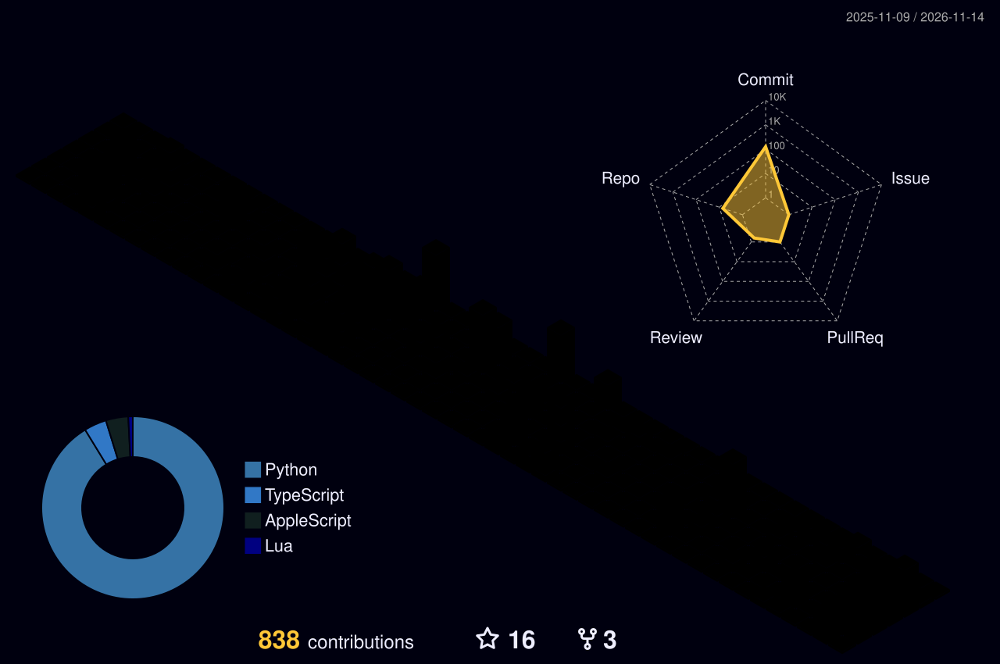

<p align="center">
  
</p>

<p align="center">
  <a href="mailto:chenjuiyu0828@gmail.com"></a>
  <a href="https://scholar.google.com/citations?user=a_hkgY8AAAAJ&hl=en"></a>
  <a href="https://orcid.org/0009-0000-6679-3670"></a>
  <a href="https://www.linkedin.com/in/rui0828/"></a>
  
</p>

<p align="center">
  
</p>

<br/>

<table align="center">
<tr>
<td width="55%" valign="top">

```yaml
# ~/whoami.yaml
name:   Chen-Jui Yu (Rui)
role:   Ph.D. Student
school: National Yang Ming Chiao Tung University
dept:   Computer Science

research:
  - Table Retrieval & Table QA
  - Tool Retrieval for LLM Agents
  - Low-Resource / Indigenous Language NLP
  - Multimodal Learning · RL

also_into:
  - Backend & System Design
  - Infra / DevOps / Self-hosted LLMs
```

</td>
<td width="45%" valign="top">

#### `▸ now`
- 🎓 Ph.D. @ **NYCU CS**
- 🗂️ Making retrievers actually understand tables
- 🛠️ Training-free tool retrieval for agents
- 🌏 NLP for Taiwan indigenous languages

#### `▸ toolbox`
<p>
  <br/>
  
</p>

</td>
</tr>
</table>

## `> cat publications.md`

<!--START_SECTION:papers-->
<p align="center">
  
  
  
</p>


#### `2026`

-  **[An LLM-Assisted Framework for Response Selection in Low-Resource Language Dialogue: A Case Study on Taiwan Indigenous Languages](https://doi.org/10.1145/3845610)**  
  <sub>En-Te Chang, <b>Chen-Jui Yu</b>, Yao-Chung Fan</sub>
-  **[CGPT: Cluster-Guided Partial Tables with LLM-Generated Supervision for Table Retrieval](https://doi.org/10.1145/3774904.3792916)**  
  <sub>Tsung-Hsiang Chou, <b>Chen-Jui Yu</b>, Shui-Hsiang Hsu, Yao-Chung Fan</sub>
-  **[STAR: Semantic Table Representation with Header-Aware Clustering and Adaptive Weighted Fusion](https://doi.org/10.1145/3774904.3792962)**  
  <sub>Shui-Hsiang Hsu, Tsung-Hsiang Chou, <b>Chen-Jui Yu</b>, Yao-Chung Fan &nbsp;·&nbsp; [arXiv](https://arxiv.org/abs/2601.15860)</sub>
-  **[ToolFuse: Documentation-Intent Fusion for Training-Free Tool Retrieval](https://doi.org/10.18653/2026.realm-1.99)**  
  <sub>Shao-Cheng Lu, Shui-Hsiang Hsu, <b>Chen-Jui Yu</b>, Fan Yao-Chung</sub>

#### `2024`

-  **[Automating True-False Multiple-Choice Question Generation and Evaluation with Retrieval-based Accuracy Differential](https://doi.org/10.18653/v1/2024.inlg-main.16)**  
  <sub><b>Chen-Jui Yu</b>, Wen Lee, Lin Tse Ke, Shih-Wei Guo, Yao-Chung Fan</sub>
-  **[Learning-From-Mistakes Prompting for Indigenous Language Translation](https://doi.org/10.18653/v1/2024.loresmt-1.15)**  
  <sub>You-Cheng Liao, <b>Chen-Jui Yu</b>, Chi-Yi Lin, He-Feng Yun, Yen-Hsiang Wang, Hsiao-Min Li, Yao-Chung Fan &nbsp;·&nbsp; [arXiv](https://arxiv.org/abs/2407.13343)</sub>

<sub><i>Auto-synced from <a href="https://openalex.org">OpenAlex</a> &amp; <a href="https://orcid.org/0009-0000-6679-3670">ORCID</a> by GitHub Actions · conference / journal versions take priority over preprints.</i></sub>
<!--END_SECTION:papers-->

## `> git log --graph`

<picture>
  <source media="(prefers-color-scheme: dark)" srcset="https://raw.githubusercontent.com/Rui0828/Rui0828/output/profile-night-rainbow.svg" />
  <source media="(prefers-color-scheme: light)" srcset="https://raw.githubusercontent.com/Rui0828/Rui0828/output/profile-gitblock.svg" />
  
</picture>

<p align="center">
  <picture>
    <source media="(prefers-color-scheme: dark)" srcset="https://github-profile-summary-cards.vercel.app/api/cards/repos-per-language?username=rui0828&theme=tokyonight" />
    <source media="(prefers-color-scheme: light)" srcset="https://github-profile-summary-cards.vercel.app/api/cards/repos-per-language?username=rui0828&theme=default" />
    
  </picture>
  <picture>
    <source media="(prefers-color-scheme: dark)" srcset="https://github-profile-summary-cards.vercel.app/api/cards/stats?username=rui0828&theme=tokyonight" />
    <source media="(prefers-color-scheme: light)" srcset="https://github-profile-summary-cards.vercel.app/api/cards/stats?username=rui0828&theme=default" />
    
  </picture>
</p>


