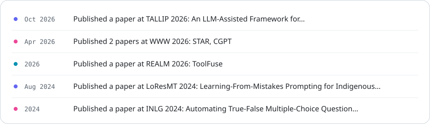
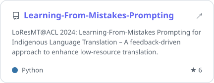
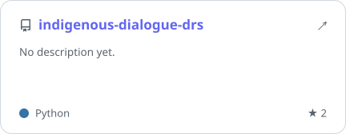
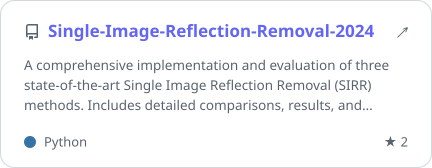

<!-- Generated by scripts/build_site.py from site.json — edit those, not this file. -->

  <a href="#readme"><picture><source media="(prefers-color-scheme: dark)" srcset="https://raw.githubusercontent.com/Rui0828/Rui0828/main/assets/site/nav-home-dark.svg" /></picture></a>&nbsp;&nbsp;
  <a href="#about"><picture><source media="(prefers-color-scheme: dark)" srcset="https://raw.githubusercontent.com/Rui0828/Rui0828/main/assets/site/nav-about-dark.svg" /></picture></a>
  <a href="#news"><picture><source media="(prefers-color-scheme: dark)" srcset="https://raw.githubusercontent.com/Rui0828/Rui0828/main/assets/site/nav-news-dark.svg" /></picture></a>
  <a href="#publications"><picture><source media="(prefers-color-scheme: dark)" srcset="https://raw.githubusercontent.com/Rui0828/Rui0828/main/assets/site/nav-publications-dark.svg" /></picture></a>
  <a href="#projects"><picture><source media="(prefers-color-scheme: dark)" srcset="https://raw.githubusercontent.com/Rui0828/Rui0828/main/assets/site/nav-projects-dark.svg" /></picture></a>
  <a href="#contact"><picture><source media="(prefers-color-scheme: dark)" srcset="https://raw.githubusercontent.com/Rui0828/Rui0828/main/assets/site/nav-contact-dark.svg" /></picture></a>

<picture><source media="(prefers-color-scheme: dark)" srcset="https://raw.githubusercontent.com/Rui0828/Rui0828/main/assets/site/hero-dark.svg" /></picture>

<picture><source media="(prefers-color-scheme: dark)" srcset="https://raw.githubusercontent.com/Rui0828/Rui0828/main/assets/site/sec-about-dark.svg" /></picture>

<picture><source media="(prefers-color-scheme: dark)" srcset="https://raw.githubusercontent.com/Rui0828/Rui0828/main/assets/site/about-dark.svg" /></picture>

<picture><source media="(prefers-color-scheme: dark)" srcset="https://raw.githubusercontent.com/Rui0828/Rui0828/main/assets/site/sec-news-dark.svg" /></picture>

<picture><source media="(prefers-color-scheme: dark)" srcset="https://raw.githubusercontent.com/Rui0828/Rui0828/main/assets/site/news-dark.svg" /></picture>

<picture><source media="(prefers-color-scheme: dark)" srcset="https://raw.githubusercontent.com/Rui0828/Rui0828/main/assets/site/sec-publications-dark.svg" /></picture>

<a href="https://doi.org/10.1145/3845610"><picture><source media="(prefers-color-scheme: dark)" srcset="https://raw.githubusercontent.com/Rui0828/Rui0828/main/assets/site/paper-0-dark.svg" /></picture></a>

<a href="https://doi.org/10.1145/3845610"><picture><source media="(prefers-color-scheme: dark)" srcset="https://raw.githubusercontent.com/Rui0828/Rui0828/main/assets/site/btn-paper-dark.svg" /></picture></a>

<a href="https://doi.org/10.1145/3774904.3792962"><picture><source media="(prefers-color-scheme: dark)" srcset="https://raw.githubusercontent.com/Rui0828/Rui0828/main/assets/site/paper-1-dark.svg" /></picture></a>

<a href="https://doi.org/10.1145/3774904.3792962"><picture><source media="(prefers-color-scheme: dark)" srcset="https://raw.githubusercontent.com/Rui0828/Rui0828/main/assets/site/btn-paper-dark.svg" /></picture></a> <a href="https://arxiv.org/abs/2601.15860"><picture><source media="(prefers-color-scheme: dark)" srcset="https://raw.githubusercontent.com/Rui0828/Rui0828/main/assets/site/btn-arxiv-dark.svg" /></picture></a>

<a href="https://doi.org/10.1145/3774904.3792916"><picture><source media="(prefers-color-scheme: dark)" srcset="https://raw.githubusercontent.com/Rui0828/Rui0828/main/assets/site/paper-2-dark.svg" /></picture></a>

<a href="https://doi.org/10.1145/3774904.3792916"><picture><source media="(prefers-color-scheme: dark)" srcset="https://raw.githubusercontent.com/Rui0828/Rui0828/main/assets/site/btn-paper-dark.svg" /></picture></a>

<a href="https://doi.org/10.18653/2026.realm-1.99"><picture><source media="(prefers-color-scheme: dark)" srcset="https://raw.githubusercontent.com/Rui0828/Rui0828/main/assets/site/paper-3-dark.svg" /></picture></a>

<a href="https://doi.org/10.18653/2026.realm-1.99"><picture><source media="(prefers-color-scheme: dark)" srcset="https://raw.githubusercontent.com/Rui0828/Rui0828/main/assets/site/btn-paper-dark.svg" /></picture></a>

<a href="https://doi.org/10.18653/v1/2024.loresmt-1.15"><picture><source media="(prefers-color-scheme: dark)" srcset="https://raw.githubusercontent.com/Rui0828/Rui0828/main/assets/site/paper-4-dark.svg" /></picture></a>

<a href="https://doi.org/10.18653/v1/2024.loresmt-1.15"><picture><source media="(prefers-color-scheme: dark)" srcset="https://raw.githubusercontent.com/Rui0828/Rui0828/main/assets/site/btn-paper-dark.svg" /></picture></a> <a href="https://arxiv.org/abs/2407.13343"><picture><source media="(prefers-color-scheme: dark)" srcset="https://raw.githubusercontent.com/Rui0828/Rui0828/main/assets/site/btn-arxiv-dark.svg" /></picture></a>

<a href="https://doi.org/10.18653/v1/2024.inlg-main.16"><picture><source media="(prefers-color-scheme: dark)" srcset="https://raw.githubusercontent.com/Rui0828/Rui0828/main/assets/site/paper-5-dark.svg" /></picture></a>

<a href="https://doi.org/10.18653/v1/2024.inlg-main.16"><picture><source media="(prefers-color-scheme: dark)" srcset="https://raw.githubusercontent.com/Rui0828/Rui0828/main/assets/site/btn-paper-dark.svg" /></picture></a>

<i>Auto-synced daily from OpenAlex &amp; ORCID · conference / journal versions take priority over preprints.</i>

<picture><source media="(prefers-color-scheme: dark)" srcset="https://raw.githubusercontent.com/Rui0828/Rui0828/main/assets/site/sec-projects-dark.svg" /></picture>

  <a href="https://github.com/Rui0828/Learning-From-Mistakes-Prompting"><picture><source media="(prefers-color-scheme: dark)" srcset="https://raw.githubusercontent.com/Rui0828/Rui0828/main/assets/site/proj-learning-from-mistakes-prompting-dark.svg" /></picture></a>&nbsp;<a href="https://github.com/Rui0828/indigenous-dialogue-drs"><picture><source media="(prefers-color-scheme: dark)" srcset="https://raw.githubusercontent.com/Rui0828/Rui0828/main/assets/site/proj-indigenous-dialogue-drs-dark.svg" /></picture></a> 
  <a href="https://github.com/Rui0828/Nginx-Ollama"><picture><source media="(prefers-color-scheme: dark)" srcset="https://raw.githubusercontent.com/Rui0828/Rui0828/main/assets/site/proj-nginx-ollama-dark.svg" /></picture></a>&nbsp;<a href="https://github.com/Rui0828/Single-Image-Reflection-Removal-2024"><picture><source media="(prefers-color-scheme: dark)" srcset="https://raw.githubusercontent.com/Rui0828/Rui0828/main/assets/site/proj-single-image-reflection-removal-2024-dark.svg" /></picture></a> 

<picture><source media="(prefers-color-scheme: dark)" srcset="https://raw.githubusercontent.com/Rui0828/Rui0828/main/assets/site/sec-activity-dark.svg" /></picture>

<picture><source media="(prefers-color-scheme: dark)" srcset="https://raw.githubusercontent.com/Rui0828/Rui0828/output/profile-night-rainbow.svg" /></picture>

<picture><source media="(prefers-color-scheme: dark)" srcset="https://raw.githubusercontent.com/Rui0828/Rui0828/main/assets/site/sec-contact-dark.svg" /></picture>

<a href="mailto:chenjuiyu0828@gmail.com"><picture><source media="(prefers-color-scheme: dark)" srcset="https://raw.githubusercontent.com/Rui0828/Rui0828/main/assets/site/contact-dark.svg" /></picture></a>

  <a href="mailto:chenjuiyu0828@gmail.com"><picture><source media="(prefers-color-scheme: dark)" srcset="https://raw.githubusercontent.com/Rui0828/Rui0828/main/assets/site/link-email-dark.svg" /></picture></a>
  <a href="https://scholar.google.com/citations?user=a_hkgY8AAAAJ&hl=en"><picture><source media="(prefers-color-scheme: dark)" srcset="https://raw.githubusercontent.com/Rui0828/Rui0828/main/assets/site/link-google-scholar-dark.svg" /></picture></a>
  <a href="https://orcid.org/0009-0000-6679-3670"><picture><source media="(prefers-color-scheme: dark)" srcset="https://raw.githubusercontent.com/Rui0828/Rui0828/main/assets/site/link-orcid-dark.svg" /></picture></a>
  <a href="https://www.linkedin.com/in/rui0828/"><picture><source media="(prefers-color-scheme: dark)" srcset="https://raw.githubusercontent.com/Rui0828/Rui0828/main/assets/site/link-linkedin-dark.svg" /></picture></a>

© Chen-Jui Yu · this page is generated by <a href="scripts/build_site.py">a script</a> and rebuilt daily by GitHub Actions

